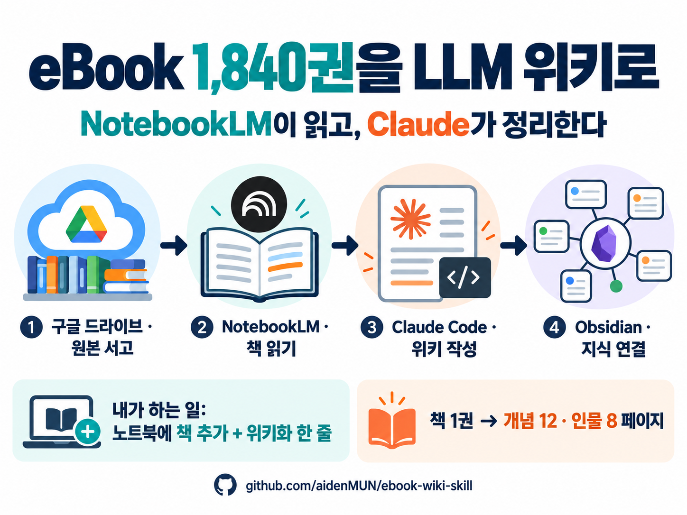

# ebook-wiki — 내 eBook으로 만드는 LLM Wiki (Claude Code 스킬)



> 보유한 eBook(PDF)을 **NotebookLM으로 읽고, Claude가 Obsidian 위키로 쌓아 가는** 개인 지식 데이터베이스 운영 스킬
> Andrej Karpathy의 [LLM Wiki](https://gist.github.com/karpathy/442a6bf555914893e9891c11519de94f) 아이디어를 eBook 서고에 맞게 구현함

*English summary: A Claude Code skill that turns your PDF eBook library into a Karpathy-style LLM Wiki. NotebookLM reads each book (driven by the Aside browser CLI), and Claude compiles the extraction into an Obsidian vault of book, concept, people and synthesis pages, while a Google Sheet tracks each book's status. Documentation is in Korean.*

---

## 왜 만들었나

- RAG나 NotebookLM은 질문할 때마다 원문을 다시 뒤져 답을 새로 조립함 → **아무것도 쌓이지 않음**
- LLM Wiki는 책을 넣을 때마다 LLM이 위키 페이지를 쓰고 고치고 연결함 → **책이 늘수록 지식이 복리로 쌓임**
- 이 스킬은 그 과정을 "노트북에 책 넣고 명령 한 줄"로 줄임

## 무엇을 하나

```
① PDF를 Drive 서고에 저장 ──"신규 확인"──▶ 도서목록 시트에 등록
② 책을 골라 NotebookLM 노트북에 추가
③ Claude Code에 "위키화 <노트북명>" 입력
   └▶ Aside가 NotebookLM에 정형 추출 프롬프트 실행 → 답변 회수
   └▶ 추출본을 10_raw/에 원본 보관 (불변)
   └▶ 책·개념·인물·종합 페이지 생성/갱신, 책 간 관점 차이 표시
   └▶ index·log 갱신, 시트 상태 "위키반영"
④ Obsidian에서 검토 → "검토완료 <노트북명>"
⑤ "질문: …"으로 위키 근거 답변, 대시보드로 분야별 현황 확인
```

| 역할 | 도구 |
|---|---|
| 원본 서고 | Google Drive 폴더 (PDF) |
| 도서 목록·진행 상태 | Google Sheet (H열 위키상태, I열 노트북) |
| 원문 읽기·1차 정리 | NotebookLM |
| 브라우저 자동화 | Aside CLI (`aside exec`) |
| 위키 작성·연결·관리 | Claude Code + 이 스킬 |
| 위키 저장소·조회 | Obsidian (Bases, Dataview) |

## 저장소 구성

```
ebook-wiki-skill/
├─ skill/ebook-wiki/          ← ~/.claude/skills/ 에 복사하는 스킬
│  ├─ SKILL.md                  명령별 절차
│  ├─ config.example.json       설정 예시 (config.json으로 복사해 사용)
│  ├─ references/aside_commands.md  검증된 Aside 지시문
│  └─ scripts/                  보조 스크립트 (Python 표준 라이브러리만 사용)
└─ vault-template/            ← 새 Obsidian 볼트로 복사하는 빈 위키 구조
   ├─ CLAUDE.md                 위키 운영 규칙 (Schema)
   ├─ 00_HOME.md · index.md · log.md
   ├─ 00_dashboard/             Bases DB 4종 + Dataview 대시보드
   ├─ 01_inbox · 10_raw · 20_books · 30_concepts · 40_entities
   ├─ 50_synthesis · 60_outputs · 80_journal · 90_assets
   └─ 99_admin/                 프롬프트(P01·P02) · 템플릿 4종 · 사람용 설명서
```

## 준비물

- [Claude Code](https://claude.com/claude-code) (CLI 또는 데스크톱 앱)
- Claude Code에 연결된 **Google Drive 도구**(시트 CSV 내려받기·파일 검색용)
- [Obsidian](https://obsidian.md) — 대시보드를 쓰려면 커뮤니티 플러그인 **Dataview**
- NotebookLM을 쓸 수 있는 Google 계정
- **Aside CLI** (NotebookLM·시트 자동 조작, 설치: `curl -fsSL https://releases.aside.com/install.sh | bash`). 없으면 추출본을 직접 붙여넣는 `위키화 inbox`로 사용 가능
- Python 3.9+ (macOS 기본 또는 Homebrew)
- 원본 서고: Google Drive 데스크톱 동기화 폴더 (예: `~/Library/CloudStorage/GoogleDrive-…/My Drive/ebooks`)

## 설치

```bash
git clone https://github.com/aidenMUN/ebook-wiki-skill.git
cd ebook-wiki-skill

# 1) 스킬 설치
mkdir -p ~/.claude/skills
cp -R skill/ebook-wiki ~/.claude/skills/
cp ~/.claude/skills/ebook-wiki/config.example.json ~/.claude/skills/ebook-wiki/config.json
# → config.json의 vault_path, library_path, sheet_id 를 내 값으로 수정

# 2) 위키 볼트 만들기 (원하는 위치로)
cp -R vault-template "<vault_path>"

# 3) 설정 확인
python3 -I ~/.claude/skills/ebook-wiki/scripts/_config.py
```

### 도서목록 시트 형식

| A | B | C | D | E | F | G | H | I |
|---|---|---|---|---|---|---|---|---|
| 연번 | 대분류 폴더 | 세부 폴더/시리즈 | 도서명 | 저자 | 파일 링크 | 폴더 링크 | 위키상태 | 노트북 |

- 1행은 헤더, H열 값: (빈칸) → `위키반영` → `검토완료` / `보류`
- PDF 파일명은 `도서명-저자.pdf` 규칙을 권장 (`신규 확인`이 이 규칙으로 도서명·저자를 추정)

## 사용법 (Claude Code에 말하기)

| 명령 | 언제 | 하는 일 |
|---|---|---|
| `신규 확인` | 서고에 새 PDF를 넣은 뒤 | 시트에 없는 책을 찾아 보여주고, 승인하면 시트에 등록 |
| `위키화 <노트북명>` | NotebookLM 노트북에 책을 추가한 뒤 | 추출 → 원본 보관 → 위키 페이지 작성 → 시트·index·log 갱신 |
| `위키화 inbox` | 추출본을 `01_inbox/`에 직접 붙여넣은 뒤 | 원본 보관 단계부터 진행 |
| `검토완료 <노트북명>` | Obsidian에서 확인한 뒤 | 시트·책 페이지 상태를 `검토완료`로 |
| `질문: …` | 언제든 | 위키 근거로 출처(책·장·쪽)를 달아 답변, 좋은 답은 종합 페이지로 저장 제안 |
| `점검` | 월 1회 | 깨진 링크·중복·고아 페이지·시트 불일치 리포트 → 승인 항목만 수정 |
| `현황` | 언제든 | 진행 상황 요약 |

`/ebook-wiki`로 스킬을 직접 불러도 됨.

## 설계 원칙

- **Raw는 불변**: NotebookLM 추출본은 `10_raw/`에 원형 보관하고 고치지 않음 → 위키의 모든 주장을 추출본 → 원본 PDF까지 거슬러 확인 가능
- **책은 미리 넣지 않음**: 노트북에 넣은 책만 위키화. 빈 페이지를 대량으로 만들지 않음
- **한 개념 = 한 페이지**: 새 책은 기존 개념 페이지에 관점을 덧붙임. 견해 차이는 `🔀 관점 차이`, 사실 차이는 `⚠️ 사실 충돌`로 구분
- **분야를 넘나드는 연결**: 같은 개념이 다른 분야 책에 나오면 한 페이지에서 비교
- **사람 영역 보호**: `80_journal/`(내 메모)은 Claude가 읽기만 함
- **frontmatter = DB 필드**: 대시보드·Bases가 그대로 집계

## 보조 스크립트

| 스크립트 | 용도 |
|---|---|
| `_config.py` | 설정 읽기·검증 |
| `extract_marked.py` | Aside 출력에서 `<<<BEGIN>>>`~`<<<END>>>` 본문만 추출 (잘림 감지) |
| `notebook_folder.py` | 노트북명을 안전한 폴더명으로 변환 |
| `sheet_lookup.py` | 시트에서 책 행 번호·상태 찾기, 상태 집계 |
| `new_files.py` | 서고에 있지만 시트에 없는 PDF 찾기 (macOS 한글 파일명 NFD 처리) |
| `check_wiki.py` | 깨진 링크·이름 중복·frontmatter 누락·고아 페이지 점검 |

## 주의 사항

- **저작권**: 위키는 개인 학습용으로 쓰는 것을 전제로 함. 원문 인용은 짧게 하고, 원문을 길게 옮겨 공개하지 않음
- **개인정보**: `config.json`에는 내 경로·시트 ID가 들어가므로 저장소에 올리지 않음 (`.gitignore`에 포함)
- **스캔 PDF**: 인식 품질이 나쁘면 추출 단계에서 `보류` 처리됨
- **NotebookLM 한도**: 요금제에 따라 노트북당 소스 수·파일 크기 한도가 다름. 큰 파일은 나눠서 올려야 할 수 있음
- **Aside 자동화**: NotebookLM·Google Sheets 화면이 바뀌면 지시문을 조정해야 할 수 있음. 실패하면 `위키화 inbox`로 계속 진행 가능
- 스킬은 NotebookLM에서 읽기·질문만 하고, 시트는 H·I열 상태만 바꿈. 시트 행 추가 등은 사용자 승인 후 진행

## 라이선스

MIT — [LICENSE](LICENSE) 참조
