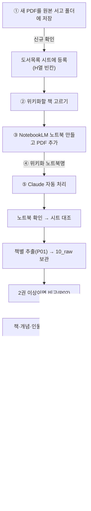

# eBook 위키화 워크플로우 설명서 v3

> 이 문서는 사람이 읽는 운영 설명서임. Claude가 따르는 상세 규칙은 [[CLAUDE]] 참조
> 사람이 할 일은 **책 고르기 · 노트북에 넣기 · 명령 한 줄 · 마지막 검토** 4가지뿐임. 나머지는 Claude가 이어서 처리함

---

## 1. 한눈에 보기



## 2. 단계별 설명

| 단계 | 누가 | 무엇을 | 결과 |
|---|---|---|---|
| ① 확보·등록 | 나 → Claude | 새 PDF를 원본 서고 폴더에 넣고 `신규 확인` 입력 | 도서목록 시트에 행 추가 (승인 후) |
| ② 책 고르기 | 나 | 이번에 위키화할 책 1~10권 선택 | — |
| ③ 노트북에 넣기 | 나 | NotebookLM에서 노트북 생성, PDF 추가 | 노트북 준비 |
| ④ 위키화 명령 | 나 | Claude Code에 `위키화 <노트북명>` 입력 | Claude가 이어받음 |
| ⑤ 자동 처리 | Claude | 3장 참조 | 위키 페이지 생성, 시트 상태 갱신 |
| ⑥ 검토 | 나 | Obsidian에서 확인 후 `검토완료 <노트북명>` 입력 | 시트 상태 `검토완료` |

- ①은 새로 확보한 책일 때만 진행함. 이미 시트에 있는 책은 ②부터 시작
- 200MB가 넘는 PDF는 NotebookLM에 올리기 전에 나눠야 함

## 3. ⑤ 단계에서 Claude가 하는 일

1. **노트북 확인**: Aside 브라우저로 NotebookLM 노트북을 열어 들어 있는 책 목록을 확인함
2. **시트 대조**: 이미 위키에 있는 책(`위키반영`·`검토완료`)은 건너뜀. 시트에 없는 책은 따로 알려줌
3. **책별 추출**: 책을 1권만 선택한 상태에서 질문지 [[P01_책별추출]]을 입력해 답변을 받음
   - 받는 항목: 인식 품질, 서지정보, 핵심 주장, 장별 구조, 핵심 개념, 인물·전통·도구, 실천 방법, 인용문, 한계, 연결 질문
   - 모든 항목에 원문 위치(장, 쪽)를 붙임
4. **원본 보관**: 답변을 `10_raw/<노트북폴더>/<도서명>_P01.md`에 그대로 저장함 (이후 수정 금지). 노트북폴더는 노트북명에서 `[ ]`를 빼고 `/`를 `_`로 바꾼 이름
5. **책끼리 비교**: 2권 이상이면 질문지 [[P02_묶음비교]]로 공통점·차이점·고유 통찰을 받음
6. **위키 페이지 작성** (책 1권씩 순서대로)
   - 책 페이지 1개 → `20_books`
   - 관련 개념·인물 페이지 생성 또는 기존 페이지에 추가 → `30_concepts`, `40_entities`
   - 다른 책과 견해가 다르면 `🔀 관점 차이`, 사실관계가 다르면 `⚠️ 사실 충돌`로 표시
7. **종합 페이지**: 2권 이상이면 묶음 종합 → `50_synthesis`
8. **마무리**: [[index]]·[[log]] 갱신, 시트 H열 `위키반영`·I열 노트북명 기입, 결과 보고

## 4. 상태 표시 (도서목록 시트 H열)

| 상태 | 의미 |
|---|---|
| (빈칸) | 서고에만 있음, 아직 위키화 안 함 |
| `위키반영` | Claude가 위키화 완료, 검토 전 |
| `검토완료` | 내가 확인함 |
| `보류` | 스캔 품질이 나빠 글자를 읽지 못함 |

## 5. 명령어 모음

| 명령 | 언제 | 하는 일 |
|---|---|---|
| `신규 확인` | Drive에 새 책을 넣은 뒤 | Drive와 시트를 대조해 새 책을 등록 (승인 후) |
| `위키화 <노트북명>` | 노트북에 책을 넣은 뒤 | 3장 전체 자동 처리 |
| `위키화 inbox` | Aside가 실패해 직접 붙여넣은 뒤 | 3장 4번부터 진행 |
| `검토완료 <노트북명>` | 결과를 확인한 뒤 | 시트 상태 `검토완료` |
| `질문: …` | 언제든 | 위키 근거로 출처를 달아 답변, 좋은 답은 종합으로 저장 제안 |
| `점검` | 월 1회 | 충돌 내용·연결 안 된 페이지·시트 불일치 등 보고 → 승인 항목만 수정 |
| `현황` | 언제든 | 진행 상황 요약 |

## 6. 결과 확인하는 곳

| 위치 | 내용 |
|---|---|
| [[00_HOME]] | 홈 화면, 바로가기 |
| [[대시보드]] | 분야별 책 수, 핵심 개념, 분야를 넘나드는 개념, 진행률 (Dataview 자동 집계) |
| `00_dashboard/*.base` | 책·개념·인물·종합 DB 표 |
| 그래프 뷰 | 책·개념 간 연결 구조 |

## 7. 문제가 생겼을 때

| 상황 | 대처 |
|---|---|
| Aside가 NotebookLM 답변을 못 가져옴 | [[P01_책별추출]]을 NotebookLM에 직접 붙여넣고, 답변을 `01_inbox/<노트북명>/<도서명>.md`로 저장한 뒤 `위키화 inbox` |
| 인식 품질이 "읽기 어려움" | 해당 책은 `보류` 처리됨. 텍스트가 있는 다른 판본을 구하거나 OCR 처리 후 다시 시도 |
| 위키 내용이 이상함 | 원본 추출본(`10_raw`)과 비교하고, Claude에게 `질문:`으로 근거를 확인하거나 수정 요청 |
| 시트 상태와 위키가 다름 | `점검` 실행 |

## 8. 실제 사용 예시

```
1. NotebookLM에서 "리더십" 노트북을 만들고 PDF 3권 추가
   (예: 종교 분야 리더십 도서 2권 + 경영 리더십 도서 1권)
2. Claude Code(작업 폴더: 볼트)에 입력 → 위키화 리더십
3. Claude 보고 확인 → Obsidian에서 책·개념 페이지, 대시보드 확인
4. 괜찮으면 입력 → 검토완료 리더십
5. 활용 → 질문: 종교 도서와 경영 도서의 리더십 정의는 어떻게 다른가?
```

## 9. 지켜야 할 것

- 위키 작업은 **ebook-wiki 스킬**로 진행함. 어느 작업 폴더의 Claude 세션에서든 `/ebook-wiki` 를 입력하거나 명령어(`위키화 …` 등)를 말하면 스킬이 [[CLAUDE]] 규칙을 읽고 실행함 (스킬 위치: `~/.claude/skills/ebook-wiki`)
- `10_raw`(원본 추출본)와 `80_journal`(내 메모)은 Claude가 고치지 않음
- 책·개념 페이지 맨 위 속성(저자·분야·노트북·상태 등)은 대시보드가 읽는 값이므로 이름을 바꾸지 않음
- NotebookLM에서 Claude는 읽기·질문만 함. 노트북·소스 삭제나 공유 설정 변경은 하지 않음

---

## 자체점검표

| # | 기준 | 반영 위치 | 평가 |
|---|---|---|---|
| 1 | 사람이 할 일이 분명한가 | 1·2장 | 충족 |
| 2 | Claude 처리 과정이 이해되는가 | 3장 | 충족 |
| 3 | 명령어를 한곳에서 찾을 수 있는가 | 5장 | 충족 |
| 4 | 결과 확인 위치가 안내되는가 | 6장 | 충족 |
| 5 | 문제 상황 대처가 있는가 | 7장 | 충족 (Aside 자동 추출은 시범 운영 후 보완 필요) |
| 6 | CLAUDE.md 규칙과 일치하는가 | 전체 | 충족 (CLAUDE.md v1.4 기준) |
